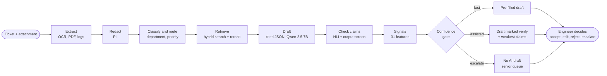
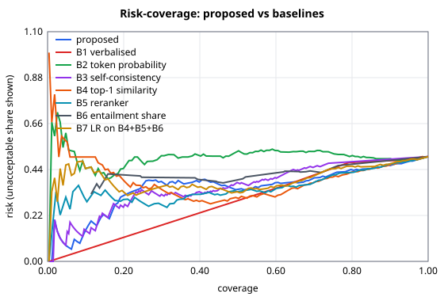
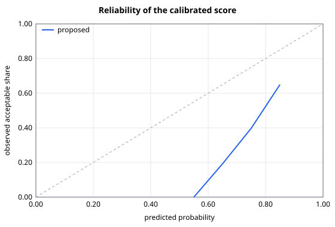

<div align="center">


# TicketSense

### Knowing when an AI draft deserves to be shown

**Evidence-grounded support-ticket resolution with a calibrated confidence gate<br>and risk-controlled human escalation**

[](https://github.com/Rishikesh10925/Ticket_Sense/actions/workflows/ci.yml)


[Overview](#overview) ·
[How it works](#how-it-works) ·
[Results](#results) ·
[Quick start](#quick-start) ·
[Progress](#development-progress) ·
[Docs](#documentation)

</div>

---

TicketSense routes IT and HR support tickets to the right department, drafts a cited reply
from a department-scoped knowledge base with a **local** language model, checks every claim
in that draft against its evidence, and then decides — with a calibrated score and
statistically certified thresholds — whether an engineer should see the draft at all.
A human engineer always makes the final call.

<table>
<tr>
<td width="33%" valign="top">

**Grounded by construction**<br>
Every step of a draft cites a knowledge-base passage. Claims are checked by an NLI model;
commands and URLs the evidence does not contain are blocked.

</td>
<td width="33%" valign="top">

**Gated, not trusted**<br>
A 31-signal confidence model scores each draft. A Learn-then-Test procedure certifies the
lane thresholds, and the gate fails closed when nothing is certified.

</td>
<td width="33%" valign="top">

**Measured honestly**<br>
Hypotheses pre-registered before any result, a sealed test read exactly once, and every
development table reproducible offline from a fresh clone.

</td>
</tr>
</table>

> [!IMPORTANT]
> **Week 12 of a 12-week roadmap.** TicketSense is a final-year B.Tech capstone at NMIMS
> MPSTME Hyderabad. The system is complete and the sealed locked test was evaluated
> **once, on 11 November 2026, against LLM-judge labels**. The planned 600-draft human
> labelling was cancelled; the human evaluation is a three-author audit, still in
> progress. All confidence numbers below are therefore **pilot results on judge labels**.

## Overview

A language model answering a support ticket can state something plausible that is simply
not true for the organisation, and its own stated confidence correlates poorly with
whether it is right. A system that trusts that number either passes wrong answers on or
escalates almost everything.

TicketSense asks one question: **can a support system decide when its own AI draft
deserves to be shown, with a measurable guarantee rather than a hunch?**

The [pre-registration](docs/prereg.md) (tag `prereg-v1`, 19 October 2026) fixes four
objectives before any confidence result existed:

| | Objective | Hypothesis |
|---|---|---|
| 1 | A confidence model that ranks drafts by correctness better than any single signal (verbalised confidence, token probability, self-consistency, top-1 retrieval similarity, entailment share) | H1 |
| 2 | A fast lane whose unacceptable-draft rate stays within a chosen budget α, certified with Learn-then-Test | H2 |
| 3 | An honest measurement of how the gate degrades on topics the knowledge base does not cover | H3 |
| 4 | A small user study of whether the lanes cut handling time without more accepted errors | H4 |

## How it works

The pipeline is a LangGraph `StateGraph` ([`ai/graph/pipeline.py`](ai/graph/pipeline.py))
that runs as a background task after a ticket is created
([`backend/app/services/pipeline.py`](backend/app/services/pipeline.py)).



Every stage writes what it produced, so any decision can be audited afterwards:
retrieval runs and every candidate's scores (`retrieval_runs`, `retrieval_hits`), the
structured draft and per-claim support (`drafts`, `draft_claims`), the signal vector
(`signal_vectors`) and the gate's decision with score, lane and top reasons
(`gate_decisions`).

### The three lanes

| Lane | When | What the engineer sees |
|---|---|---|
| **Fast** | score ≥ certified fast threshold | Pre-filled draft with citations |
| **Assisted** | between the two thresholds | Draft marked "verify", side-by-side evidence, weakest claims first |
| **Escalate** | below the assisted threshold, the draft cannot answer, the shift guard fires, or no thresholds are certified | No AI draft; evidence only; senior queue |

The **shift guard** escalates a ticket when the router is unsure (department probability
below 0.5, or another department within 0.1). It was chosen on held-out topics to limit
damage on questions the knowledge base does not cover.

## Features

Everything in this table is implemented and in `main`.

| Area | What exists | Where |
|---|---|---|
| **Intake** | Ticket form with optional attachment; OCR for images, text extraction for PDFs and logs | [`ai/ocr/`](ai/ocr/) |
| **Privacy** | PII redaction (emails, phone numbers, Aadhaar, PAN, card numbers, secrets) before any model call or log | [`ai/security/pii.py`](ai/security/pii.py) |
| **Routing** | Department and priority classifier v2 (MiniLM embeddings + TF-IDF, logistic regression) with max-probability and entropy uncertainty | [`ai/models/classifier_v2.py`](ai/models/classifier_v2.py) |
| **Retrieval** | PostgreSQL full text + pgvector HNSW, reciprocal-rank fusion, cross-encoder rerank; department and served-article filters inside SQL; every run logged | [`ai/retrieval/`](ai/retrieval/) |
| **Drafting** | Structured JSON drafts, a citation on every step, a can-answer flag; delimited data blocks and schema rejection | [`ai/generation/drafting.py`](ai/generation/drafting.py) |
| **Claim checking** | Claim splitting, NLI entailment (`nli-deberta-v3-base`), verbatim-quote rule | [`ai/grounding/claims.py`](ai/grounding/claims.py) |
| **Injection defence** | Output screen: URLs, commands and code in a step must come from a passage that step cites, not only from its Warnings section | [`ai/security/output_screen.py`](ai/security/output_screen.py) |
| **Signals** | 31 features over retrieval, reranker, grounding, consistency, routing, evidence and ticket groups | [`ai/signals/features.py`](ai/signals/features.py) |
| **Confidence model** | Logistic regression and XGBoost, group-aware CV, Platt calibration, top reasons per decision | [`ai/confidence_model/`](ai/confidence_model/) |
| **Gate** | Versioned certified thresholds in the database, fail-closed default, shift guard, every decision logged | [`ai/gate/service.py`](ai/gate/service.py) |
| **Risk control** | Learn-then-Test on a pre-specified grid; AURC, e-AURC, AUROC, ECE, Brier; group-aware and paired bootstrap | [`ai/evaluation/`](ai/evaluation/) |
| **Benchmark** | 1,775 synthetic tickets (types A, B, C1, C2) with gold provenance, leakage-safe splits, content-hash freeze, sealed locked test | [`data/benchmark/`](data/benchmark/) |
| **Knowledge base** | 120 articles in five departments; 24 withheld to create unseen topics | [`data/kb/`](data/kb/) |
| **Web app** | End-user, engineer and admin views; lane badges and filter; cited draft with side-by-side evidence and unsupported-claim highlights; reason-coded actions with a decision timer | [`frontend/`](frontend/) |
| **Admin console** | Tickets, approvals, customers, engineers, departments, knowledge base, analytics (lane dashboard), model health, error budget | [`frontend/src/`](frontend/src/) |
| **Human evaluation tools** | Blinded annotation tool, assignment planner with double annotation, groundedness-audit and three-author audit pages with Krippendorff's alpha and adjudication | [`docs/audit/`](docs/audit/), [`docs/author-audit/`](docs/author-audit/) |
| **User-study tool** | `/study` screen: manual vs workbench condition on two matched sets of 20 tickets, counterbalanced, timed on the server; blind-grading export and H4 analysis | [`docs/study/user-study/`](docs/study/user-study/README.md) |
| **Evaluation tooling** | Baselines B0–B7, ablations, shift experiment, kappa family, LLM groundedness check, full-pipeline red team, latency and cost, one-command reproduction, one-shot locked-test runner | [`ai/evaluation/`](ai/evaluation/) |

## Results

Development and locked-test numbers, each linked to the committed file it comes from.

### System

| Measure | Value | Source |
|---|---|---|
| Benchmark | 1,775 tickets, frozen; train 824 · val 135 · calib 262 · test 271 · unseen 283 | [FREEZE_v1.json](data/benchmark/FREEZE_v1.json) |
| Department routing | macro-F1 **0.911** on validation, 0.829 on unseen topics | [classifier-v2.json](docs/results/classifier-v2.json) |
| Retrieval (type A tickets) | Recall@5 **1.000**; zero cross-department or withheld-article leakage | [retrieval-v1.json](docs/results/retrieval-v1.json) |
| Schema-valid drafts | 1,773 of 1,775 (99.9%) | [week 5 logbook](docs/logbook/week05.md) |
| Prompt-injection red team | **0 of 40** attacks reach an engineer through the full pipeline and gate (5 of 40 got through before the output screen) | [redteam-v3-pipeline.json](docs/results/redteam-v3-pipeline.json) |
| Latency and cost | median **6.4 s** per ticket (drafting 5.7 s, gate 6 ms); one LLM call, about 1,440 tokens | [latency-cost.md](docs/latency-cost.md) |
| Claim-checker audit (human) | 3 members, 136 claims: NLI accepts 64% (95% CI 45–79) of the claims they rejected; the LLM check 79% | [audit-v1.json](docs/results/audit-v1.json) |

### Locked test — run once, 11 November 2026, judge labels

271 sealed drafts, 49.8% acceptable. Nothing was refitted.

| Hypothesis | Decision | Detail |
|---|---|---|
| **H1** confidence model beats single signals | No reliable improvement | AURC 0.352 [0.263, 0.452] vs 0.398 for B4 (top-1 similarity); difference −0.045 [−0.136, 0.066] |
| **H2** certified fast lane | Not testable | No fast threshold certified in 999 of 1,000 resplits |
| **H3** degradation on unseen topics | Reported | Unseen AURC 0.992 (only 2 of 283 drafts acceptable); the shift guard cuts unseen drafts shown from 152 to 58 |

Lane mix on the test set: fast 0%, assisted 81%, escalate 19%. Full table with all
baselines: [locked-final-judge.md](docs/results/locked-final-judge.md).

<table>
<tr>
<td width="50%"></td>
<td width="50%"></td>
</tr>
<tr>
<td align="center"><sub>Risk–coverage, proposed vs baselines</sub></td>
<td align="center"><sub>Reliability diagram</sub></td>
</tr>
</table>

**What this means.** Held out, the confidence model is no better than its best single
signal: the direction matches validation, but the interval crosses zero. The fast lane
never opens on these labels, so in practice every answering draft goes to the assisted
lane or is escalated. On unseen topics almost every draft is unacceptable; the guard
reduces exposure but does not remove it.

## Quick start

<details open>
<summary><b>Prerequisites</b></summary>

- [Docker](https://docs.docker.com/get-docker/) with Compose
- [uv](https://docs.astral.sh/uv/) and Python 3.12 (`backend/pyproject.toml` requires ≥ 3.11)
- Node.js 24 and npm (the CI version)
- [Ollama](https://ollama.com) for drafting; a GPU is recommended. Without one, set
  `LLM_CLIENT=stub` (offline extractive drafts, never for results).

</details>

**1. Clone and configure**

```bash
git clone https://github.com/Rishikesh10925/Ticket_Sense.git
cd Ticket_Sense
cp .env.example .env              # then replace the placeholders, see Configuration
ollama pull qwen2.5:7b-instruct   # the drafting model
```

**2. Install and start** — `db`, `api` and `web` with Docker Compose; migrations run on API start

```bash
python tasks.py setup             # backend (+ai, dev extras) and frontend dependencies
python tasks.py up                # docker compose up -d --build
```

On Linux and macOS, `make <task>` runs the same tasks.

**3. Load the knowledge base, demo accounts and gate thresholds**

```bash
uv run --project backend --extra ai python ai/embeddings/embed_knowledge_base.py
python tasks.py demo

cd backend
uv run python -m app.scripts.load_thresholds \
  --report docs/results/confidence-v1-judge.json \
  --guard docs/results/shift-v1-judge.json --version t-judge-2
```

> [!NOTE]
> Without an active threshold set **every ticket escalates** — the gate fails closed.
> `t-judge-2` was certified on LLM-judge labels and includes the shift guard.

**4. Open the app**

| Service | URL |
|---|---|
| Web app | http://localhost:3000 |
| API | http://localhost:8000 (`GET /health`) |
| Interactive API docs | http://localhost:8000/docs |

The frontend also runs with hot reload via `npm run dev` in `frontend/`.

### Demo accounts

Created by `python tasks.py demo` ([`seed_demo_users.py`](backend/app/scripts/seed_demo_users.py)) and, for
the annotator, [`seed_annotation_demo.py`](backend/app/scripts/seed_annotation_demo.py). Password for all: `Demo@123`.
These are for local development only.

| Role | Email | Lands on |
|---|---|---|
| End user | `customer@demo.local` | `/end-user` |
| Engineer (Networking) | `engineer@demo.local` | `/engineer` |
| Engineers (SAP · Cloud · HR) | `rishikesh.engineer@demo.local` · `aashritha.engineer@demo.local` · `shivaganesh.engineer@demo.local` | `/engineer` |
| Admin | `admin@demo.local` | `/admin` |
| Annotator | `reviewer@demo.local` | `/annotate` |

### A five-minute tour

1. **As the end user**, submit a ticket such as *"VPN keeps disconnecting every 10 minutes"*.
   The pipeline runs in the background (about 6 s median).
2. **As the Networking engineer**, open it from the queue: the cited draft, the evidence
   beside it, the lane, the score and the gate's top reasons. Accept, edit, reject or
   escalate with a reason code.
3. **As the end user** again, read the final reply. End users never see drafts, scores or
   evidence.
4. **As the admin**, open **Analytics** for the lane mix, engineer actions and latency, and
   **Error Budget** for the gate's risk budget.

<details>
<summary><b>Configuration</b> — environment variables in <code>.env</code></summary>

<br>

Copy [`.env.example`](.env.example) to `.env`. Never commit `.env`.

| Variable | Purpose | Example / placeholder |
|---|---|---|
| `POSTGRES_USER`, `POSTGRES_PASSWORD`, `POSTGRES_DB`, `POSTGRES_PORT` | Database container | `<db-user>`, `<db-password>`, `ticketsense`, `5432` |
| `DATABASE_URL` | Backend connection string | `postgresql+asyncpg://<db-user>:<db-password>@localhost:5432/ticketsense` |
| `APP_ENV` | Anything other than `development` or `test` requires a real `JWT_SECRET_KEY` | `development` |
| `CORS_ORIGINS` | Allowed frontend origins, comma-separated | `http://localhost:5173,http://localhost:3000` |
| `JWT_SECRET_KEY` | Token signing key; ≥ 32 characters outside development | `<long-random-secret>` |
| `JWT_ALGORITHM`, `JWT_EXPIRE_MINUTES` | Token settings | `HS256`, `60` |
| `LLM_CLIENT` | `ollama`, or `stub` (offline extractive drafts, never for results) | `ollama` |
| `LLM_MODEL` | Ollama model tag | `qwen2.5:7b-instruct` |
| `OLLAMA_HOST` | Ollama URL for local runs | `http://localhost:11434` |
| `OLLAMA_HOST_FROM_DOCKER` | Ollama URL seen from the API container | `http://host.docker.internal:11434` |
| `GROUNDING_SCORER` | `nli`, or `lexical` (tests only) | `nli` |
| `TS_DEVICE_EMBED`, `TS_DEVICE_RERANK`, `TS_DEVICE_NLI` | Optional: pin a model to `cpu` or `cuda` ([`ai/devices.py`](ai/devices.py)) | `cpu`, `cpu`, `cuda` |
| `TEST_DATABASE_URL` | Optional test database (default `ticketsense_test` on localhost) | `postgresql+asyncpg://…/ticketsense_test` |

Generate a secret with `python -c "import secrets; print(secrets.token_hex(32))"`.

</details>

<details>
<summary><b>Task runner</b> — <code>python tasks.py &lt;task&gt;</code></summary>

<br>

| Task | Does |
|---|---|
| `setup` | `uv sync --extra ai --extra dev` in `backend/`, `npm ci` in `frontend/` |
| `up` | `docker compose up -d --build` |
| `lint` | ruff, mypy (typed research packages), frontend lint |
| `test` | `ai/tests`, then backend tests (needs Postgres) |
| `openapi` | Write [`docs/openapi.json`](docs/openapi.json) from the app |
| `reproduce` | Regenerate every evaluation table and figure ([`reproduce.py`](ai/evaluation/reproduce.py)) |
| `demo` | Seed demo users |
| `e2e` | Playwright end-to-end tests against the running stack |

Offline research scripts document their options in their docstrings, for example
[`batch_drafts.py`](ai/generation/batch_drafts.py), [`batch_judge.py`](ai/judge/batch_judge.py),
[`build_features.py`](ai/signals/build_features.py), [`train.py`](ai/confidence_model/train.py)
and [`run_redteam.py`](ai/redteam/run_redteam.py).

</details>

## Technology stack

| Layer | Technologies |
|---|---|
| **Backend** | Python 3.12 · FastAPI · SQLAlchemy 2 (async, asyncpg) · Alembic · Pydantic settings · PyJWT · bcrypt |
| **Database** | PostgreSQL 16 + pgvector (`pgvector/pgvector:pg16`) — full text and HNSW vectors in one store |
| **AI pipeline** | LangGraph · sentence-transformers (`all-MiniLM-L6-v2`, `ms-marco-MiniLM-L-6-v2`, `nli-deberta-v3-base`) · scikit-learn · XGBoost · EasyOCR · pypdf |
| **Language models** | Local via [Ollama](https://ollama.com): `qwen2.5:7b-instruct` drafts, `llama3.1:8b` is the offline judge ([ADR 002](docs/adr/002-llm-provider.md)) |
| **Frontend** | React 19 · TypeScript · Vite · React Router 7 · TanStack Query 5 |
| **Quality** | uv · ruff · mypy · pytest · oxlint · Playwright · gitleaks · Docker Compose · GitHub Actions |

## Project structure

```text
Ticket_Sense/
├── ai/                       The research pipeline, importable from the backend
│   ├── benchmark/            Ticket generator, splits, validator, freeze, release
│   ├── confidence_model/     Dataset, model, training, ablations, shift guard
│   ├── embeddings/           Chunking and knowledge-base ingestion
│   ├── evaluation/           Metrics, bootstrap, risk control, agreement, reproduce, locked test
│   ├── gate/                 Gate service: scoring, lanes, shift guard
│   ├── generation/           LLM client and cache, structured drafting
│   ├── graph/                LangGraph nodes and pipeline
│   ├── grounding/            NLI claim checker, consistency, LLM check
│   ├── judge/                LLM judge and batch judging
│   ├── models/               Department and priority classifiers
│   ├── ocr/                  Attachment text extraction
│   ├── redteam/              Prompt-injection red-team runner
│   ├── retrieval/            Hybrid search, run log, evaluation
│   ├── security/             PII redaction, output screen
│   ├── signals/              Signal vector, baselines
│   ├── study/                User-study ticket sets and H4 analysis
│   └── tests/                Unit tests (no database or model server needed)
├── backend/                  FastAPI app: routers, models, schemas, services, scripts, tests
├── db/migrations/            Alembic migrations 0001 to 0023
├── data/
│   ├── kb/                   120 knowledge-base articles (Markdown, five departments)
│   ├── benchmark/            benchmark_v1.jsonl, splits, FREEZE records
│   ├── annotation/           Labelling selection and locked-test seal
│   ├── eval/                 Evaluation inputs without the locked test, for offline reproduction
│   └── redteam/              40-ticket injection set
├── docs/                     Design docs, ADRs, results, logbooks, report, model card, audits
├── frontend/                 React app and Playwright end-to-end tests
├── docker-compose.yml        db, api, web
├── tasks.py                  Cross-platform task runner (the Makefile delegates to it)
└── render.yaml               Render deployment blueprint (API + database)
```

<details>
<summary><b>API reference</b></summary>

<br>

Interactive docs at `/docs`; frozen spec in [docs/openapi.json](docs/openapi.json); contract
with status per endpoint in [docs/api-contract.md](docs/api-contract.md).

| Group | Endpoints |
|---|---|
| Health and auth | `GET /health`, `POST /auth/register`, `POST /auth/login`, `GET /auth/me` |
| Tickets | `POST /tickets`, `GET /tickets` (filters `status`, `priority`, `department_id`, `lane`, `sort`), `GET /tickets/{id}`, `GET /tickets/{id}/attachment` |
| Evidence, draft, gate | `GET /tickets/{id}/evidence`, `GET /tickets/{id}/draft`, `GET /tickets/{id}/decision` |
| Review and escalation | `POST /tickets/{id}/feedback`, `GET /tickets/{id}/escalation`, `POST /tickets/{id}/resolve-escalation`, `GET /escalations/pending`, `POST /escalations/{id}/approve`, `POST /escalations/{id}/reject` |
| Admin | `GET/POST /users`, `PATCH /users/{id}`, `GET /departments`, `PATCH /departments/{id}/threshold` (V1, unused by the gate), `GET/POST /knowledge-base`, `GET /analytics/summary`, `GET /analytics/lanes`, `GET /analytics/confidence-model`, `GET /gate/thresholds` |
| Messaging | `GET /messages/contacts`, `GET /messages/thread/{other_user_id}`, `POST /messages` |
| Annotation | `GET /annotate/next`, `POST /annotate/{assignment_id}` |
| User study | `GET /study/next`, `POST /study/tasks/{task_id}`, `GET /study/kb` |

Scores, drafts, evidence and gate decisions are visible to engineers and admins only.

</details>

<details>
<summary><b>Data model</b></summary>

<br>

Migrations live in [`db/migrations/versions/`](db/migrations/versions/) (0001 to 0023).

| Group | Tables |
|---|---|
| Accounts and tickets | `users`, `departments`, `tickets` (redacted text, lane), `feedback`, `escalations` (tier), `messages` |
| Knowledge base | `knowledge_base`, `kb_chunks` (tsvector + vector), `embeddings` |
| Pipeline log | `retrieval_runs`, `retrieval_hits`, `drafts`, `draft_claims`, `signal_vectors`, `gate_thresholds`, `gate_decisions` |
| Benchmark and labels | `benchmark_tickets`, `judge_verdicts`, `annotators`, `annotation_assignments`, `labels` |
| User study | `study_participants`, `study_tasks` |

</details>

## Testing and reproducibility

```bash
python tasks.py lint        # ruff, mypy, frontend lint
python tasks.py test        # ai/ unit tests, then backend tests against Postgres
python tasks.py e2e         # Playwright, needs the running stack
python tasks.py reproduce   # regenerate docs/results/
```

- **CI** ([`ci.yml`](.github/workflows/ci.yml)) runs on every push: ruff, mypy, gitleaks;
  `ai/` unit tests with a 70% coverage floor on the evaluation and pipeline packages;
  backend tests against pgvector; frontend lint, type check and build.
- **Backend tests** use a separate `ticketsense_test` database with the offline `stub`
  drafter and `lexical` claim checker, so they need no model server.
- **Integrity checks.** Training and evaluation refuse to run if the benchmark freeze or
  the locked-test seal no longer verifies.
- **Offline reproduction.** A fresh clone rebuilds every committed development table and
  figure byte for byte from [`data/eval/`](data/eval/) — no database, GPU or model server,
  about a minute. Last checked 2026-10-30: no file changed.

  ```bash
  python -m venv .venv && .venv/Scripts/pip install -r ai/requirements-reproduce.txt   # Windows
  python3 -m venv .venv && .venv/bin/pip install -r ai/requirements-reproduce.txt      # Linux/macOS
  .venv/Scripts/python ai/evaluation/reproduce.py --offline
  git status   # nothing changed
  ```

- **Locked test.** [`locked_eval.py`](ai/evaluation/locked_eval.py) applies the
  pre-registered H1–H3 rules. `--rehearse` runs the same code on the validation split.
  The single `--final` run (`--labels judge`) was made on 2026-11-11 and is not repeated.

## Security

- **PII** is redacted before any model call, retrieval log or stored draft
  ([`pii.py`](ai/security/pii.py)).
- **Prompt injection.** Ticket text, attachments and evidence reach the model only inside
  delimited data blocks; drafts must validate against a JSON schema with a citation on
  every step; the output screen blocks URLs, commands and code the cited evidence lacks.
- **Isolation.** Retrieval is filtered by department and served status inside SQL; tests
  assert zero cross-department retrieval.
- **Access control.** JWT with role-based access; end users never receive drafts, scores
  or evidence; annotator and participant roles cannot reach ticket endpoints.
- **Secrets.** The API refuses to start outside development with a default or short
  `JWT_SECRET_KEY`; gitleaks scans every push.
- Security tests: [`test_security.py`](backend/tests/test_security.py),
  [`test_role_matrix.py`](backend/tests/test_role_matrix.py),
  [`test_config_secret.py`](backend/tests/test_config_secret.py). Week 11 audit and fixes:
  [08-security-and-responsible-ai.md](docs/report/08-security-and-responsible-ai.md).

## Development progress

<table>
<tr>
<th width="34%">✅ Completed</th>
<th width="33%">🔄 In progress</th>
<th width="33%">⏳ Upcoming</th>
</tr>
<tr>
<td valign="top">

- Full system: three roles, gated pipeline, fail-closed lanes
- Benchmark freeze and sealed locked test
- Hybrid retrieval, cited drafting, claim checking
- Red team through the full pipeline (0 of 40)
- Baselines B0–B7, confidence model, ablations, shift study
- Groundedness audit (3 members, 136 claims)
- Locked test, run once (judge labels)
- Report chapters drafted; logbooks weeks 1–12
- Offline reproduction from a fresh clone

</td>
<td valign="top">

- Three-author audit: batch 1 rated, adjudication in progress
- Final report
- Rubric pilot: 1 of 3 members' labels in the repository

</td>
<td valign="top">

- Three-author audit batch 2
- User study with 6–8 participants (tool ready)
- Human review of the knowledge base (24 of 120 articles AI-checked only, none human-reviewed)
- Fresh-setup timing; release tag `v1.0`
- Demo video, slides and rehearsals
- Licence decision

</td>
</tr>
</table>

### Roadmap

| Week | Milestone | Status |
|---|---|---|
| 1–5 | Foundations, walking skeleton, data engine, hybrid retrieval, cited drafts | ✅ `v0.1`, `prereg-v1`, `v0.2` |
| 6 | Full pipeline, security, red team, annotation tool, hard gate | ✅ |
| 7 | Signal pipeline, baselines | ✅ on judge labels |
| 8 | Confidence model, calibration, sealed test set | ✅ on judge labels |
| 9 | Three-lane gate, reviewer workbench, shift guard | ✅ |
| 10 | Analytics dashboard, evaluation suite, locked-test rehearsal | ✅ |
| 11 | User-study tool, security hardening, bug bash, report draft v1 | ✅ tool ready · sessions pending |
| 12 | Locked test, human evaluation, release, presentation | 🔄 locked test done · author audit, `v1.0` and presentation pending |

Weekly evidence and decisions: logbooks
[1](docs/logbook/week01.md) · [2](docs/logbook/week02.md) · [3](docs/logbook/week03.md) ·
[4](docs/logbook/week04.md) · [5](docs/logbook/week05.md) · [6](docs/logbook/week06.md) ·
[7](docs/logbook/week07.md) · [8](docs/logbook/week08.md) · [9](docs/logbook/week09.md) ·
[10](docs/logbook/week10.md) · [11](docs/logbook/week11.md) · [12](docs/logbook/week12.md).
Full plan: [docs/plan/](docs/plan/).

<details>
<summary><b>Changes to the pre-registered protocol</b></summary>

<br>

Hypotheses were tagged `prereg-v1` on 19 October 2026, before any confidence result. Every
later change was logged with its reason in [docs/prereg.md](docs/prereg.md) before the data
it affects was read:

- exact frozen counts (19 Oct); KB amendment 1 (20 Oct); H2 "not testable" rule (21 Oct)
- H3 exposure and e-AURC, B3 added to the locked evaluation (25 Oct); H2 Platt refit per resplit (26 Oct)
- outside-reviewer audit kept as an exploratory pilot (2 Nov); 600-draft labelling cancelled in favour of the three-author audit (3 Nov)
- locked test run once against LLM-judge labels (11 Nov)

</details>

## Limitations

- **Synthetic data.** Benchmark and knowledge base are synthetic; retrieval is saturated
  (Recall@5 = 1.0), so retrieval numbers are an upper bound ([datasheet](docs/datasheet.md)).
- **Judge labels.** Confidence results use LLM-judge labels. Humans agree poorly even with
  each other on these drafts (three-author batch 1: Krippendorff's alpha 0.21 on
  acceptable vs not), so the judge is not a stand-in for people.
- **No fast lane.** No threshold is certified for a 10% error budget, so shown drafts go to
  the assisted lane.
- **Unseen topics.** Thresholds certified on known topics do not hold for unseen ones; the
  shift guard reduces exposure but does not remove it.
- **Permissive claim checker.** NLI passes most claims the members rejected in the
  groundedness audit.
- **Output-screen trade-off.** Screen-v2 blocks 87 of 1,484 shown benchmark drafts,
  including 47 the judge rated acceptable that contain commands not in their evidence.
- **Knowledge-base review.** No article is human-reviewed yet; the freeze is provisional
  until it is ([checklists](docs/kb-review/)).
- **V1 leftovers.** `ai/confidence/` and `PATCH /departments/{id}/threshold` no longer
  route tickets since the Week 9 lane switch.
- **Local GPU.** `uv run` re-syncs from the lock file and installs CPU PyTorch; a CUDA build
  must be reinstalled afterwards.

## Documentation

| Topic | Documents |
|---|---|
| Design | [Architecture](docs/architecture.md) (V1, partly superseded) · [LangGraph pipeline](docs/langgraph-pipeline.md) · [ADRs](docs/adr/) · [Ticket lifecycle](docs/ticket-lifecycle.md) · [Authentication](docs/authentication.md) |
| Research | [Pre-registration](docs/prereg.md) · [Results draft](docs/results-draft.md) · [Results data](docs/results/) · [Confidence model](docs/confidence-model.md) · [Retrieval](docs/retrieval.md) |
| Report | [Chapters 1–11](docs/report/README.md) · [Model card](docs/model-card.md) · [Datasheet](docs/datasheet.md) · [Third-party licences](docs/third-party-licences.md) |
| Human evaluation | [Labelling rubric](docs/labelling-rubric.md) · [Groundedness audit](docs/audit/) · [Three-author audit](docs/author-audit/README.md) · [User study](docs/study/user-study/README.md) |
| Project | [Logbooks](docs/logbook/) · [Submission checklist](docs/submission-checklist.md) · [Definition of done](docs/definition-of-done.md) · [Demo storyboard](docs/demo/storyboard.md) |

> **Screenshots.** Application screenshots are not yet in the repository. The figures in
> [Results](#results) are generated by the evaluation code.

## Contributing

This is a three-person capstone; outside contributions are not expected yet. Team workflow
([ADR 001](docs/adr/001-repository-and-workflow.md)):

- One branch per member per piece of work (`week<N>-<member>-<topic>`), merged into `main`
  only when CI is green; no pull requests.
- Short, lowercase commit messages.
- A change is done when it meets [docs/definition-of-done.md](docs/definition-of-done.md);
  run `python tasks.py lint` and `python tasks.py test` before pushing.

## License

No licence has been chosen yet; until one is added, all rights are reserved by the authors.
Licences of the models, data and libraries used are listed in
[docs/third-party-licences.md](docs/third-party-licences.md).

## Authors and acknowledgements

<table>
<tr>
<td align="center" width="33%"><a href="https://github.com/Rishikesh10925"><b>Rishikesh</b></a><br><sub>@Rishikesh10925</sub></td>
<td align="center" width="33%"><a href="https://github.com/AashrithaReddy-19"><b>Aashritha Reddy</b></a><br><sub>@AashrithaReddy-19</sub></td>
<td align="center" width="33%"><a href="https://github.com/shivv-14"><b>Shivaganesh</b></a><br><sub>@shivv-14</sub></td>
</tr>
</table>

B.Tech CSE (Data Science), NMIMS MPSTME Hyderabad.

Built on open models and libraries including Qwen 2.5 and Llama 3.1 (via Ollama),
sentence-transformers (`all-MiniLM-L6-v2`, `ms-marco-MiniLM-L-6-v2`, `nli-deberta-v3-base`),
LangGraph, FastAPI, PostgreSQL with pgvector, and React.

<div align="center">
<br>
<sub>TicketSense · a human always makes the final decision</sub>
</div>
