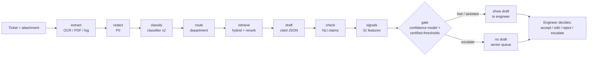

<div align="center">

# TicketSense

**Calibrated, evidence-grounded ticket resolution with risk-controlled human escalation**


[](https://github.com/Rishikesh10925/Ticket_Sense/actions/workflows/ci.yml)


</div>

TicketSense classifies and routes IT and HR support tickets, retrieves evidence from a
department-scoped knowledge base, drafts a cited reply with a local language model, and
checks every claim in that draft against its evidence. An independently trained
confidence model then turns those checks into a calibrated score, and a statistically
controlled gate sends the ticket down one of three lanes: **fast** (pre-filled draft),
**assisted** (draft marked "verify", with its weakest claims) or **escalate** (no AI
draft). A human engineer always makes the final decision.

> [!IMPORTANT]
> **In development.** This is a final-year capstone at NMIMS MPSTME Hyderabad, built
> to a 12-week roadmap. Weeks 1 to 8 are implemented and Week 9 is under way. Model and
> threshold numbers below are **provisional**: they are computed on LLM-judge labels
> while the human labels the project reports are still being collected.

## Table of contents

- [Problem and objectives](#problem-and-objectives)
- [Features](#features)
- [Architecture](#architecture)
- [Technology stack](#technology-stack)
- [Repository structure](#repository-structure)
- [Getting started](#getting-started)
- [Configuration](#configuration)
- [Usage](#usage)
- [API](#api)
- [Data model](#data-model)
- [Testing and evaluation](#testing-and-evaluation)
- [Current status and results](#current-status-and-results)
- [Screenshots](#screenshots)
- [Security](#security)
- [Limitations and known issues](#limitations-and-known-issues)
- [Roadmap](#roadmap)
- [Contributing](#contributing)
- [License](#license)
- [Authors and acknowledgements](#authors-and-acknowledgements)

## Problem and objectives

A language model answering a support ticket can state something plausible that is not
true for the organisation, and its own stated confidence correlates poorly with whether
it is right. A system that trusts that number either passes wrong answers on or
escalates almost everything.

TicketSense asks one question: **can a support system reliably decide when its own AI
draft deserves to be shown, with a measurable guarantee rather than a hunch?**

Objectives (from the [pre-registration](docs/prereg.md)):

1. An independently trained confidence model that ranks drafts by correctness better
   than single signals (verbalised confidence, token probability, self-consistency,
   top-1 retrieval similarity, entailment share).
2. A risk-controlled fast lane whose unacceptable-draft rate stays at or below a chosen
   budget α, selected with a Learn-then-Test procedure.
3. An honest measurement of how the gate degrades on topics the knowledge base does not
   cover.
4. A small user study of whether the lanes reduce handling time without increasing
   accepted errors.

## Features

### Implemented

| Area | What exists |
|---|---|
| Intake | Ticket form with optional attachment; OCR for images, text extraction for PDFs and logs (`ai/ocr/`) |
| Privacy | PII redaction (emails, phone numbers, Aadhaar, PAN, card numbers, secrets) before any model call or log (`ai/security/pii.py`) |
| Routing | Department and priority classifier v2 (MiniLM embeddings + TF-IDF, logistic regression) with max-probability and entropy uncertainty (`ai/models/classifier_v2.py`) |
| Retrieval | Hybrid search over `kb_chunks`: PostgreSQL full text + pgvector HNSW, reciprocal-rank fusion, cross-encoder rerank; department and served-article filters in SQL; cross-department probe; every run logged (`ai/retrieval/`) |
| Drafting | Structured JSON drafts with a citation on every step and a can-answer flag; delimited data blocks and schema rejection (`ai/generation/drafting.py`) |
| Claim checking | Claim splitting and NLI entailment scoring (`cross-encoder/nli-deberta-v3-base`); verbatim-quote rule (`ai/grounding/claims.py`) |
| Injection defence | Output screen: URLs, commands and code in a step must come from a passage that step cites (`ai/security/output_screen.py`) |
| Signals | A 31-feature signal vector per draft over retrieval, reranker, grounding, consistency, routing, evidence and ticket groups (`ai/signals/features.py`) |
| Confidence model | Logistic regression and XGBoost with group-aware CV, Platt calibration and top reasons (`ai/confidence_model/`) |
| Gate | Versioned, certified lane thresholds in the database; every decision logged with score, lane and reasons; tickets routed by lane, with a fail-closed default and an optional shift guard (`ai/gate/service.py`) |
| Risk control | Learn-then-Test thresholds on a pre-specified grid; AURC, e-AURC, AUROC, ECE, Brier; group-aware and paired bootstrap (`ai/evaluation/`) |
| Benchmark | 1,775 synthetic tickets (types A, B, C1, C2) with gold provenance, a leakage-safe split manifest, a freeze record with content hashes and a sealed locked test set (`data/benchmark/`) |
| Knowledge base | 120 articles in five departments (SAP, Cloud, Database, HR, Networking), 24 withheld to create unseen topics (`data/kb/`) |
| Web app | React 19 app with end-user, engineer and admin views: ticket detail with cited draft, side-by-side evidence and unsupported-claim highlights; engineer actions with reason codes and a decision timer; admin control centre incl. an **Error Budget** screen |
| Labelling | Blinded annotation tool for outside reviewers, seeded assignment planner with double annotation and adjudication; browser pages for the groundedness audit and rubric pilot (`docs/audit/`, `docs/pilot/`) |
| Evaluation tooling | Baselines B0 to B7, feature-group ablations, kappa / weighted kappa / Fleiss' kappa, LLM groundedness check, red-team runner, latency measurement, one-command reproduction |

### In progress (Week 9)

- Workbench layouts per lane (fast, assisted, escalate)
- Unseen-topic shift experiments and the values for the shift guard
- Analytics for lane mix, acceptance, latency and confidence distribution
- User-study kit (ticket sets, consent form, task script, SUS questionnaire)

### Planned

- Human labels for 600 drafts (150 double-labelled) and confidence model / thresholds
  refitted on them
- Locked-test evaluation (Week 10), shift study, user study (Week 11), release (Week 12)

See [Roadmap](#roadmap).

## Architecture

The pipeline is a LangGraph `StateGraph` ([`ai/graph/pipeline.py`](ai/graph/pipeline.py))
that runs as a background task after a ticket is created
([`backend/app/services/pipeline.py`](backend/app/services/pipeline.py)).



Each stage writes what it produced: retrieval runs and every candidate's scores
(`retrieval_runs`, `retrieval_hits`), the structured draft and per-claim support
(`drafts`, `draft_claims`), the signal vector (`signal_vectors`) and the gate's decision
(`gate_decisions`). Design notes: [docs/langgraph-pipeline.md](docs/langgraph-pipeline.md),
[docs/architecture.md](docs/architecture.md) (V1, partly superseded), and the ADRs in
[docs/adr/](docs/adr/).

Lanes ([Blueprint V2 §9.1]):

| Lane | Condition | What the engineer sees |
|---|---|---|
| Fast | score ≥ fast threshold | Pre-filled draft with citations |
| Assisted | between the thresholds | Draft marked "verify", evidence, weakest claims |
| Escalate | below the assisted threshold, the draft cannot answer, the shift guard fires, or no thresholds are certified | No AI draft; evidence; senior queue |

[Blueprint V2 §9.1]: docs/plan/

## Technology stack

| Layer | Tools |
|---|---|
| Backend | Python 3.12, FastAPI, SQLAlchemy 2 (async) with asyncpg, Alembic, Pydantic settings, PyJWT, bcrypt |
| Database | PostgreSQL 16 with pgvector (`pgvector/pgvector:pg16`) |
| AI pipeline | LangGraph, sentence-transformers (`all-MiniLM-L6-v2`, `cross-encoder/ms-marco-MiniLM-L-6-v2`, `cross-encoder/nli-deberta-v3-base`), scikit-learn, XGBoost, EasyOCR, pypdf |
| Language models | Local, via [Ollama](https://ollama.com): `qwen2.5:7b-instruct` drafts; `llama3.1:8b` is the offline judge ([ADR 002](docs/adr/002-llm-provider.md)) |
| Frontend | React 19, TypeScript, Vite, React Router 7, TanStack Query 5 |
| Tooling | uv, ruff, mypy, pytest, oxlint, Playwright, Docker Compose, GitHub Actions |

## Repository structure

```text
.
├── ai/                     # The research pipeline (importable from the backend)
│   ├── benchmark/          # Ticket generator, splits, validator, freeze, KB loader
│   ├── confidence_model/   # Dataset loader, model, training, ablations, artifacts
│   ├── embeddings/         # Chunking and KB ingestion
│   ├── evaluation/         # Metrics, bootstrap, risk control, agreement, latency, reproduce
│   ├── gate/               # Gate service (scoring, lanes, shift guard)
│   ├── generation/         # LLM client and cache, structured drafting, batch drafting
│   ├── graph/              # LangGraph nodes and pipeline
│   ├── grounding/          # NLI claim checker, consistency, LLM check, audit selection
│   ├── judge/              # LLM judge and batch judging
│   ├── models/             # Classifiers (V1 and v2) and artifacts
│   ├── redteam/            # Prompt-injection red-team runner
│   ├── retrieval/          # Hybrid search, run log, evaluation
│   ├── security/           # PII redaction, output screen
│   ├── signals/            # Signal vector, baselines, model-side signals
│   ├── confidence/         # V1 confidence model (superseded by confidence_model/)
│   └── tests/              # Unit tests for ai/ (no database or model server needed)
├── backend/                # FastAPI app (routers, models, schemas, services, scripts) and tests
├── db/migrations/          # Alembic migrations 0001 to 0022
├── data/
│   ├── kb/                 # 120 knowledge-base articles (Markdown, five departments)
│   ├── benchmark/          # benchmark_v1.jsonl, splits, FREEZE records
│   ├── annotation/         # Labelling selection and locked-test seal
│   ├── redteam/            # 40-ticket injection set
│   └── sample_screenshots/ # Example ticket attachments used in OCR tests
├── docs/                   # Design docs, ADRs, results, logbooks, audit and pilot tools
├── frontend/               # React app and Playwright end-to-end tests
├── docker-compose.yml      # db, api, web
├── tasks.py                # Cross-platform task runner (Makefile delegates to it)
└── render.yaml             # Render deployment blueprint (API + database)
```

## Getting started

### Prerequisites

- [Docker](https://docs.docker.com/get-docker/) with Compose
- [uv](https://docs.astral.sh/uv/) and Python 3.12 (`backend/pyproject.toml` requires ≥ 3.11)
- Node.js 24 and npm (the CI version)
- [Ollama](https://ollama.com) for drafting with the local model; a GPU is recommended.
  Without one, set `LLM_CLIENT=stub` (see [Configuration](#configuration)).

### Install and run

```bash
git clone https://github.com/Rishikesh10925/Ticket_Sense.git
cd Ticket_Sense
cp .env.example .env              # then edit the placeholders, see Configuration

ollama pull qwen2.5:7b-instruct   # the drafting model

python tasks.py setup             # backend (+ai, dev extras) and frontend dependencies
python tasks.py up                # db, api and web with Docker Compose (migrations run on API start)
```

On Linux and macOS, `make <task>` runs the same tasks.

Then load the knowledge base into the database (embeds articles into `kb_chunks`):

```bash
uv run --project backend --extra ai python ai/embeddings/embed_knowledge_base.py
```

Create demo accounts (one per role; credentials are listed in
[docs/authentication.md](docs/authentication.md)):

```bash
python tasks.py demo
```

Activate a certified threshold set for the gate. **Without one, every ticket escalates**
(the safe default). The provisional set below was certified on LLM-judge labels:

```bash
cd backend
uv run python -m app.scripts.load_thresholds \
  --report docs/results/confidence-v1-judge.json --version t-judge-1
```

| Service | URL |
|---|---|
| Web app | http://localhost:3000 |
| API | http://localhost:8000 (`GET /health`) |
| API docs (FastAPI) | http://localhost:8000/docs |

The frontend can also run with hot reload via `npm run dev` in `frontend/`.

## Configuration

Copy [`.env.example`](.env.example) to `.env`. Never commit `.env`.

| Variable | Purpose | Example / placeholder |
|---|---|---|
| `POSTGRES_USER`, `POSTGRES_PASSWORD`, `POSTGRES_DB`, `POSTGRES_PORT` | Database container | `<db-user>`, `<db-password>`, `ticketsense`, `5432` |
| `DATABASE_URL` | Backend connection string | `postgresql+asyncpg://<db-user>:<db-password>@localhost:5432/ticketsense` |
| `APP_ENV` | Environment name | `development` |
| `CORS_ORIGINS` | Allowed frontend origins, comma-separated | `http://localhost:5173,http://localhost:3000` |
| `JWT_SECRET_KEY` | Token signing key | `<long-random-secret>` |
| `JWT_ALGORITHM`, `JWT_EXPIRE_MINUTES` | Token settings | `HS256`, `60` |
| `LLM_CLIENT` | Drafting client: `ollama`, or `stub` (offline extractive drafts, never for results) | `ollama` |
| `LLM_MODEL` | Ollama model tag | `qwen2.5:7b-instruct` |
| `OLLAMA_HOST` | Ollama URL for local runs | `http://localhost:11434` |
| `OLLAMA_HOST_FROM_DOCKER` | Ollama URL seen from the API container (compose) | `http://host.docker.internal:11434` |
| `GROUNDING_SCORER` | Claim checker: `nli`, or `lexical` (tests only) | `nli` |
| `TS_DEVICE_EMBED`, `TS_DEVICE_RERANK`, `TS_DEVICE_NLI` | Optional: pin a local model to `cpu` or `cuda` ([`ai/devices.py`](ai/devices.py)) | `cpu`, `cpu`, `cuda` |
| `TEST_DATABASE_URL` | Optional: test database (default `ticketsense_test` on localhost) | `postgresql+asyncpg://…/ticketsense_test` |

## Usage

| Role | Where | What they do |
|---|---|---|
| End user | Web app home | Submit a ticket, follow its status and the final reply |
| Department engineer | Queue → ticket | Review the cited draft and evidence, see the gate's lane and reasons, accept / edit / reject / escalate with reason codes |
| Admin | Control centre (`/admin`) | Tickets, approvals, users, departments, knowledge base, analytics, model health, error budget |
| Annotator (outside reviewer) | `/annotate` | Blinded labelling of drafts with the rubric |

Task runner (`python tasks.py <task>`):

| Task | Does |
|---|---|
| `setup` | `uv sync --extra ai --extra dev` in `backend/`, `npm ci` in `frontend/` |
| `up` | `docker compose up -d --build` |
| `lint` | ruff, mypy (typed research packages), frontend lint |
| `test` | `ai/tests`, then backend tests (needs Postgres) |
| `openapi` | Write [`docs/openapi.json`](docs/openapi.json) from the app |
| `reproduce` | Regenerate every evaluation table ([`ai/evaluation/reproduce.py`](ai/evaluation/reproduce.py)) |
| `demo` | Seed demo users |
| `e2e` | Playwright end-to-end tests against the running stack |

Offline research scripts (each documents its own options in its docstring), for example:
[`ai/generation/batch_drafts.py`](ai/generation/batch_drafts.py),
[`ai/judge/batch_judge.py`](ai/judge/batch_judge.py),
[`ai/signals/build_features.py`](ai/signals/build_features.py),
[`ai/confidence_model/train.py`](ai/confidence_model/train.py),
[`ai/redteam/run_redteam.py`](ai/redteam/run_redteam.py).

## API

Interactive docs are served at `/docs`; the frozen spec is
[docs/openapi.json](docs/openapi.json) and the contract with status per endpoint is
[docs/api-contract.md](docs/api-contract.md).

| Group | Endpoints |
|---|---|
| Health and auth | `GET /health`, `POST /auth/register`, `POST /auth/login`, `GET /auth/me` |
| Tickets | `POST /tickets`, `GET /tickets` (filters: `status`, `priority`, `department_id`, `lane`, `sort`), `GET /tickets/{id}`, `GET /tickets/{id}/attachment` |
| Evidence, draft and gate | `GET /tickets/{id}/evidence`, `GET /tickets/{id}/draft`, `GET /tickets/{id}/decision` |
| Review and escalation | `POST /tickets/{id}/feedback`, `GET /tickets/{id}/escalation`, `POST /tickets/{id}/resolve-escalation`, `GET /escalations/pending`, `POST /escalations/{id}/approve`, `POST /escalations/{id}/reject` |
| Admin | `GET/POST /users`, `PATCH /users/{id}`, `GET /departments`, `PATCH /departments/{id}/threshold`, `GET/POST /knowledge-base`, `GET /analytics/summary`, `GET /analytics/confidence-model`, `GET /gate/thresholds` |
| Messaging | `GET /messages/contacts`, `GET /messages/thread/{other_user_id}`, `POST /messages` |
| Annotation | `GET /annotate/next`, `POST /annotate/{assignment_id}` |

Scores, drafts, evidence and gate decisions are visible to engineers and admins only;
end users never see them.

## Data model

Migrations live in [`db/migrations/versions/`](db/migrations/versions/) (0001 to 0022).
Main tables:

| Group | Tables |
|---|---|
| Accounts and tickets | `users`, `departments`, `tickets` (incl. redacted text, lane), `feedback`, `escalations` (tier), `messages` |
| Knowledge base | `knowledge_base`, `kb_chunks` (tsvector + vector), `embeddings` |
| Pipeline log | `retrieval_runs`, `retrieval_hits`, `drafts`, `draft_claims`, `signal_vectors`, `gate_thresholds`, `gate_decisions` |
| Benchmark and labels | `benchmark_tickets`, `judge_verdicts`, `annotators`, `annotation_assignments`, `labels` |

Full schema documentation: **To be documented** (see the migration files for column
definitions).

## Testing and evaluation

```bash
python tasks.py lint
python tasks.py test      # ai/ unit tests, then backend tests against Postgres
python tasks.py e2e       # needs the running stack
python tasks.py reproduce # regenerates docs/results/ tables
```

- Backend tests run against a separate `ticketsense_test` database (created and migrated
  automatically) with the offline `stub` drafter and `lexical` claim checker, so they need
  no model server.
- CI ([`.github/workflows/ci.yml`](.github/workflows/ci.yml)) runs lint (ruff, mypy,
  gitleaks), the ai/ unit tests, the backend tests against pgvector, and the frontend
  lint and build on every push.
- Evaluation outputs are versioned JSON in [`docs/results/`](docs/results/); training
  and evaluation refuse to run if the benchmark freeze or the locked-test seal no
  longer verifies.

## Current status and results

Weekly progress, decisions and findings are in the logbooks:
[week 1](docs/logbook/week01.md) · [2](docs/logbook/week02.md) ·
[3](docs/logbook/week03.md) · [4](docs/logbook/week04.md) · [5](docs/logbook/week05.md) ·
[6](docs/logbook/week06.md) · [7](docs/logbook/week07.md) · [8](docs/logbook/week08.md).

| Measure | Value | Source |
|---|---|---|
| Benchmark | 1,775 tickets, frozen; splits train 824 / val 135 / calib 262 / test 271 / unseen 283 | [FREEZE_v1.json](data/benchmark/FREEZE_v1.json) |
| Department routing (classifier v2) | macro-F1 0.911 on validation, 0.829 on unseen topics | [classifier-v2.json](docs/results/classifier-v2.json) |
| Retrieval, type A tickets | Recall@5 1.000, zero cross-department or withheld-article leakage | [retrieval-v1.json](docs/results/retrieval-v1.json) |
| Schema-valid drafts | 1,773 / 1,775 (99.9%) | [week 5 logbook](docs/logbook/week05.md) |
| Prompt-injection red team | 0 of 40 attacks succeed with the output screen (5 of 40 without it) | [redteam-v2.json](docs/results/redteam-v2.json), [redteam-v1.json](docs/results/redteam-v1.json) |
| Latency per ticket | median 6.8 s, of which drafting 6.0 s | [latency-v1.json](docs/results/latency-v1.json) |
| Confidence model (provisional) | validation AURC 0.149 vs. 0.173 for the best single baseline | [confidence-v1-judge.json](docs/results/confidence-v1-judge.json), [baselines-v1-judge.json](docs/results/baselines-v1-judge.json) |

"Provisional" means the target labels come from an LLM judge, not from people; these
numbers show the pipeline works and are not the project's results.

Human work still open: outside reviewer labels (0 of 600), human review of the
knowledge base (0 of 120 articles; 24 SAP articles AI-checked only), the groundedness
audit (1 of 3 members done) and the rubric pilot (1 of 3).

## Screenshots

Application screenshots: **To be documented.**

The repository includes sample ticket attachments used by the OCR tests, for example
[`data/sample_screenshots/networking_vpn_error.png`](data/sample_screenshots/networking_vpn_error.png).

## Security

- PII is redacted before any model call, retrieval log or stored draft; the original
  values stay only on the ticket row ([`ai/security/pii.py`](ai/security/pii.py)).
- Ticket text, attachments and evidence reach the model only inside delimited data
  blocks with tag neutralising; drafts must validate against a JSON schema with a
  citation on every step; the output screen blocks URLs, commands and code that the
  cited evidence does not contain.
- Retrieval is filtered by department and served status inside SQL; tests assert zero
  cross-department retrieval.
- Role-based access with JWT; end users never receive drafts, scores or evidence; the
  annotator role cannot reach ticket endpoints.
- Security tests run in CI (`backend/tests/test_security.py`, `test_role_matrix.py`).
- `gitleaks` scans every push. Keep secrets in `.env`, never in the repository.

## Limitations and known issues

- **Synthetic data.** The benchmark and knowledge base are synthetic; retrieval on it is
  saturated (Recall@5 = 1.0), so retrieval numbers are an upper bound. See
  [docs/datasheet.md](docs/datasheet.md).
- **Provisional labels.** Model, baseline and threshold numbers use LLM-judge labels until
  human labels are collected.
- **No fast lane yet.** On the current calibration data no threshold can be certified
  for a 10% error budget, so shown drafts go to the assisted lane.
- **Unseen topics.** Thresholds certified on known topics do not hold for unseen ones;
  the shift guard exists but its values are not set yet (Week 9).
- **Human review outstanding.** The benchmark freeze is provisional until the 120
  articles are human-reviewed.
- **V1 leftovers.** `ai/confidence/` and the per-department threshold
  (`PATCH /departments/{id}/threshold`, admin Departments screen) no longer route
  tickets since the Week 9 lane switch.
- **Local GPU environment.** `uv run` re-syncs the environment from the lock file and
  installs the CPU build of PyTorch; a CUDA build installed for speed must be reinstalled
  afterwards.

## Roadmap

| Week | Focus | Status |
|---|---|---|
| 1–5 | Foundations, walking skeleton, data engine, hybrid retrieval, cited drafts | ✅ Done (`v0.1`, `prereg-v1`, `v0.2`) |
| 6 | Full pipeline run, security, red team, annotation tool, hard gate | Code done; gate review pending human items |
| 7 | Signal pipeline, baselines, labelling sprint 1 | Code done; labels pending |
| 8 | Confidence model, calibration, sealed test set | Code done; labels and kappa pending |
| 9 | Three-lane gate, workbench, robustness, shift experiments | In progress |
| 10 | Locked evaluation | Planned |
| 11 | User study, hardening, writing | Planned |
| 12 | Final integration, release, presentation | Planned |

Full plan: [docs/plan/](docs/plan/).

## Contributing

This is a three-person capstone; outside contributions are not expected yet. The team
workflow ([ADR 001](docs/adr/001-repository-and-workflow.md)):

- One branch per member per week (`week<N>-<member>-<topic>`), merged into `main` only
  when CI is green; no pull requests.
- Short, lowercase commit messages.
- A change is done when it meets [docs/definition-of-done.md](docs/definition-of-done.md).
- Run `python tasks.py lint` and `python tasks.py test` before pushing.

## License

No license has been chosen yet: **To be documented.** Until one is added, all rights are
reserved by the authors.

## Authors and acknowledgements

- Rishikesh ([@Rishikesh10925](https://github.com/Rishikesh10925))
- Aashritha Reddy ([@AashrithaReddy-19](https://github.com/AashrithaReddy-19))
- Shivaganesh ([@shivv-14](https://github.com/shivv-14))

B.Tech CSE (Data Science), NMIMS MPSTME Hyderabad.

Built on open models and libraries including Qwen2.5 and Llama 3.1 (via Ollama),
sentence-transformers models (`all-MiniLM-L6-v2`, `ms-marco-MiniLM-L-6-v2`,
`nli-deberta-v3-base`), LangGraph, FastAPI, PostgreSQL with pgvector, and React.
