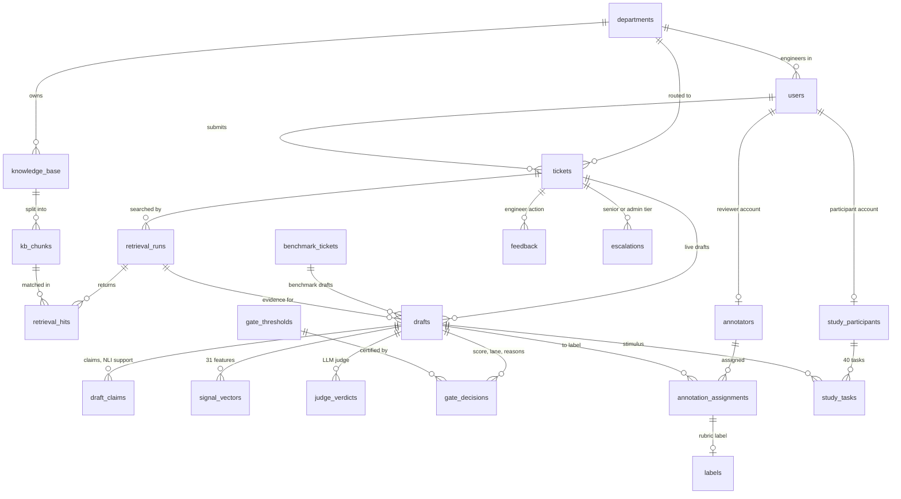

# 3. System design

*Owner: Rishikesh. Draft v1 (architecture and implementation).*

## 3.1 Architecture

| Layer | Technology | Where |
|---|---|---|
| Web app | React 19, Vite, TanStack Query | `frontend/` |
| API | FastAPI, SQLAlchemy (async), Alembic (23 migrations) | `backend/`, `db/migrations/` |
| Database | PostgreSQL with pgvector | `docker-compose.yml` |
| Pipeline | LangGraph state graph | `ai/graph/` |
| Language models | Ollama, local: `qwen2.5:7b-instruct` drafts; `llama3.1:8b` judges | `ai/generation/`, `ai/judge/` |
| Retrieval | MiniLM embeddings, keyword search, reciprocal-rank fusion, cross-encoder reranker | `ai/retrieval/` |
| Confidence and gate | XGBoost or logistic regression, Platt calibration, Learn-then-Test | `ai/confidence_model/`, `ai/gate/`, `ai/evaluation/` |

Everything runs on one laptop with an 8 GB GPU; no external API is called.

## 3.2 Roles

- **End user** submits tickets and sees only the final reply.
- **Department engineer** works a queue of their department's tickets, sorted and badged by
  lane, and accepts, edits, rejects or escalates drafts.
- **Admin** approves escalations, manages users, departments and the knowledge base, and
  sees the lane dashboard and the certified thresholds.
- Two restricted accounts exist for research only: `annotator` (blinded labelling, `/annotate`)
  and `participant` (user study, `/study`). Neither can open real tickets.

## 3.3 Pipeline

```
extract -> redact -> classify -> route -> retrieve -> draft -> check -> signals -> gate -> [lane] -> show | escalate
```

| Stage | What it does |
|---|---|
| extract | OCR or text extraction from an attachment |
| redact | Replaces personal data with placeholders before any model sees the ticket |
| classify, route | Department classifier (embedding + TF-IDF features); a cross-department probe measures how well other departments match |
| retrieve | Hybrid retrieval over the knowledge base |
| draft | Structured JSON: numbered steps, each citing passage numbers, or "cannot answer" with the missing information |
| check | Output screen (Chapter 8), then NLI support score for every claim |
| signals | 31 features: retrieval, reranker, grounding, consistency, routing, evidence and ticket signals |
| gate | Confidence model score, shift guard, certified thresholds → lane |

Fail-closed: no draft, no thresholds, a failed screen or a fired guard all mean escalate.
Every gate decision is stored with its score, reasons and threshold version.

## 3.4 Data model

23 tables (migrations 0001 to 0023). The relationships below are generated from the
foreign keys in `backend/app/models/`; the knowledge-base embedding tables and messages
are left out for readability.



Three design rules follow from this:

- **Everything a decision used is stored with it.** A gate decision points to the draft,
  its signal vector and the exact threshold version, so any lane can be explained later.
- **Live and benchmark drafts share one table.** A draft belongs to a live ticket or to a
  benchmark ticket; the confidence model trains on benchmark drafts and scores live ones
  with the same features.
- **Labels never sit on the draft.** Human labels hang off blinded assignments, judge
  verdicts off the draft, so the two sources cannot be mixed by accident.

## 3.5 Implementation notes

- **Reproducibility.** The benchmark and the locked-test selection are hashed; every
  training or evaluation run verifies them first. Model training is single-threaded for
  bit-for-bit results, and rows load in a fixed order (a fresh-clone test found that row
  order changed the tables).
- **Testing.** 155 AI unit tests and the backend suite run in CI; coverage of the pipeline
  and evaluation packages is 82%, and CI fails below 70%.
- **Latency.** Median 6.4 s per ticket, 88% of it drafting; the gate adds 6 ms
  ([latency-cost.md](../latency-cost.md)).
