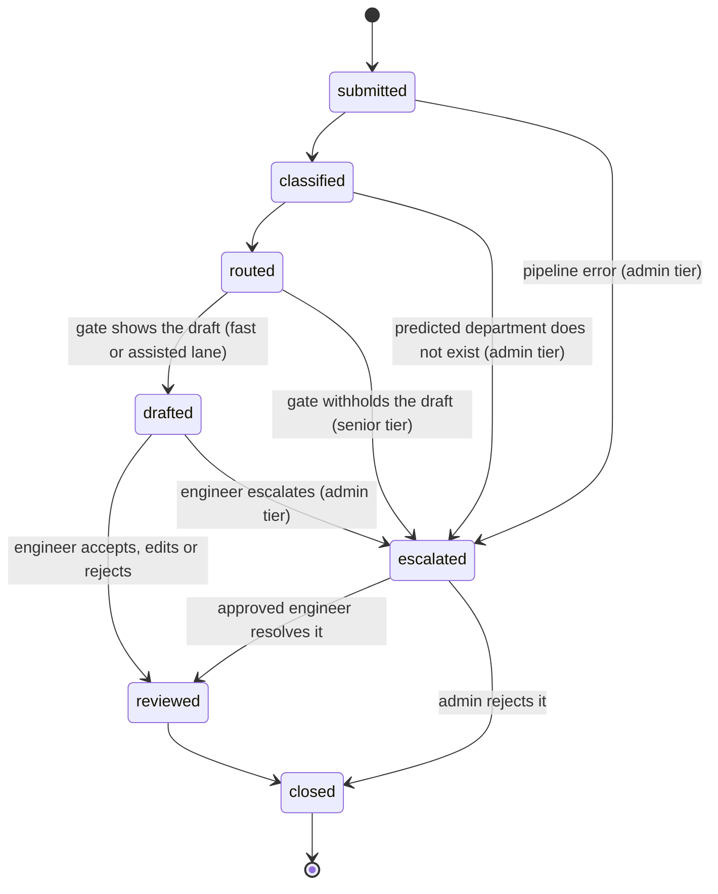

# Ticket lifecycle state machine

Implemented in `backend/app/services/ticket_lifecycle.py` (`can_transition`,
`transition`); the `tickets.status` column and its `ck_tickets_status` constraint match.
First written in Week 3; updated in Week 12 to the lifecycle the code now enforces.

## States

| State | Meaning | Set by |
|---|---|---|
| `submitted` | Created by an end user | `POST /tickets` |
| `classified` | Department, priority and sentiment predicted | pipeline (`app/services/pipeline.py`) |
| `routed` | Assigned to an existing department | pipeline |
| `drafted` | The gate showed a cited draft to the department's engineers | pipeline |
| `escalated` | No draft is shown; an escalation row says why and at which tier | pipeline, or an engineer (`POST /tickets/{id}/feedback`) |
| `reviewed` | A human decided on the reply | engineer feedback, or `POST /tickets/{id}/resolve-escalation` |
| `closed` | Terminal | admin |

## Rules

- **No skipping and no going back.** Only the arrows above are valid; `transition()`
  raises on anything else, so code never writes a status string directly.
- **`closed` is terminal.**
- **No ticket is left waiting with nobody responsible (Week 12).** If the background
  pipeline raises, the attempt is rolled back and the ticket escalates to an admin with
  the error type only (the message could quote ticket text). If the classifier predicts
  a department that does not exist, the ticket escalates instead of stopping at
  `classified`. In both cases the ticket has no department; approving the escalation to
  an engineer routes it to that engineer's department.
- **Tiers.** `senior`: the gate withheld the draft. `admin`: an engineer escalated a
  draft, or the pipeline could not route or finish the ticket.

Tests: `backend/tests/test_ticket_lifecycle.py`, `backend/tests/test_pipeline_failures.py`.
